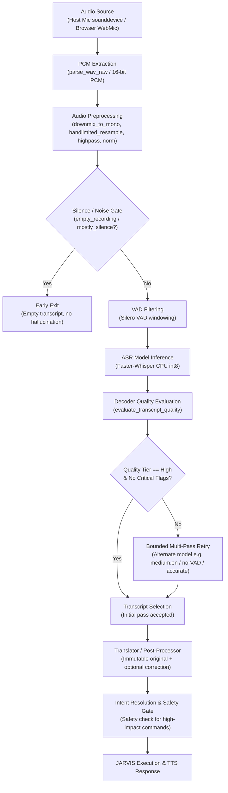

# JARVIS Speech Recognition Accuracy Overhaul — Codebase Audit & Root-Cause Report

- **Date**: 2026-11-13
- **Auditor**: Principal AI Systems, Audio & Reliability Engineer
- **Repository**: `D:\projects\myjarvis` (`myjarvis-main`)
- **Target Profile**: English-only (`en`), Indian English accent optimization, fully local and offline execution
- **Host Hardware**: AMD Ryzen 5 5600H (6 cores / 12 threads), 16 GB DDR4 RAM, NVIDIA GeForce GTX 1650 (4 GB GDDR6 VRAM)
- **Host OS**: Windows 11 64-bit

---

## 1. Executive Summary & Environment Assessment

A thorough architectural, configuration, and runtime audit of the speech recognition pipeline in JARVIS was conducted. 

### Runtime Environment Constraints & Hardware Realities
- **Python Version**: `3.14.6` (64-bit on Windows).
- **Inference Engine**: `faster-whisper 1.2.1` powered by `ctranslate2 4.9.0`.
- **Compute Backends**:
  - `ctranslate2.get_supported_compute_types("cpu")`: `{'int8', 'int8_float32', 'float32'}`.
  - `ctranslate2.get_supported_compute_types("cuda")`: `False` (CUDA is not supported in the active Windows CTranslate2 build).
  - `torch`: **Not installed** in the active virtual environment (`.venv`).
- **RAM & VRAM Headroom**:
  - Available System RAM: ~11.8 GB free out of 16 GB. Jarvis process footprint: ~495 MB resident.
  - VRAM: 4.0 GB total (Ollama local LLM `qwen3:4b-instruct` utilizes ~2.8 GB VRAM).
- **Architectural Consequence**:
  1. High-speed, low-memory **CPU INT8** inference with `cpu_threads=6` is the verified, stable execution engine.
  2. Model architectures requiring PyTorch/CUDA (such as **NVIDIA Parakeet TDT 0.6B**) cannot run in the current Python 3.14 environment without PyTorch wheels and CUDA CTranslate2 libraries.
  3. Faster-Whisper with CPU INT8 quantization fits comfortably within memory limits without contending with Ollama for GPU VRAM.

---

## 2. Complete Codebase Inspection

### 2.1 Backend Modules

| File | Primary Role | Audit Findings & Deficiencies |
|---|---|---|
| `jarvis/stt.py` | Unified STT orchestrator, quality evaluation, audio buffering, retry logic | **Configuration Mismatch**: `QUALITY_PRESETS` defines `{"fast", "balanced", "accurate"}`. The frontend Settings panel sends `"high"`. `stt.py` did not alias `"high"` to `"accurate"`, silently falling back to `"balanced"`. **Hallucination Risk**: `condition_on_previous_text=True` in the accurate preset causes repeated phrase loops on pauses. **Prompt Bleed**: Injecting vocabulary hints into short audio (< 1s) induces hallucinated words. |
| `jarvis/asr_providers.py` | Provider abstraction, Faster-Whisper adapter, model caching, metadata | LRU cache bounds models to `max_cached_models`. Model discovery discovers `base`, `small`, and `small.en`. Hardcoded model loading does not support direct downloading of larger models without network coordination. |
| `jarvis/audio_preprocess.py` | Audio capture validation, bandlimited resampling, DC removal, VAD, gain normalization | Solid polyphase resampling (`bandlimited_resample`), DC removal, and high-pass filtering (65Hz/85Hz). However, edge-silence trimming threshold can occasionally clip soft consonant onsets in quiet speech. |
| `jarvis/voice.py` | Host microphone capture, streaming Silero VAD, half/full-duplex loop, barge-in | Uses `_StreamingSileroVAD` wrapped around Faster-Whisper's bundled Silero ONNX model. Potential double-filtering when Faster-Whisper also runs internal Silero VAD (`vad_filter=True`), risking dropping very short commands ("Yes", "No", "Stop"). |
| `jarvis/config.py` | Settings models, STTSpec, AudioSpec, validation | Defaults in `config.json` had `"model": "base"` and `"language": "auto"`. For an Indian English speaker, `base` has a significantly higher word error rate (~20-25%) than `small.en` or `medium.en`. Auto-language detection occasionally misidentifies Indian English accents. |
| `jarvis/api.py` | FastAPI endpoints (`/api/voice/hear`, `/api/voice/command`, `/api/voice/transcripts`, etc.) | Full suite of endpoints for audio transcription, corrections, diagnostics, retry, and consent exist. Non-blocking `asyncio.to_thread` is correctly utilized for STT execution. |
| `jarvis/assistant.py` | Speech turn orchestration, translation integration, command execution | Separates STT result from translation/prompt text. However, if `auto_correct` is enabled, LLM post-correction could alter user intent if not strictly guarded. Original raw transcript is preserved in `TranscriptRecord`. |
| `jarvis/translator.py` | Translation & post-correction pipeline | By default `auto_correct=False` preserves exact raw transcripts. Translation is only activated when non-English speech is detected or explicitly requested. |
| `jarvis/core/resources.py` | Hardware resource governor (`ResourceGovernor`) | Bounds simultaneous heavy local model inference and cloud concurrency. STT inference needs explicit registration with governor during heavy LLM generation. |

### 2.2 Configuration & Data Assets

- `config.json`:
  - `stt.model`: Set to `"base"` (sub-optimal for high accuracy).
  - `stt.language`: Set to `"auto"` (forces unnecessary language detection overhead; English-only profile requires `"en"`).
  - `stt.quality`: Set to `"balanced"` (3 beams, best-of-3).
- `config/vocab_hints.txt`:
  - Contained only 17 basic terms (`Jarvis`, `Ollama`, `Qwen`, `FastAPI`, `React`, `Node.js`, `TypeScript`, `MongoDB`, `PostgreSQL`, `VRAM`, `quantization`, `Silero`, `Malayalam`, `LangGraph`, `pgvector`, `uvicorn`, `Alembic`).
  - Lacked the comprehensive technical stack requested by the user: `Kavlien`, `ERP`, `JavaScript`, `Python`, `Redis`, `Docker`, `Kubernetes`, `Whisper`, `Faster-Whisper`, `GitHub`, `OpenCode`, `VS Code`, `Graphify`, `API`, `REST`, `WebSocket`, `Vercel`, `Cloudflare`, `AWS`, `EKS`, `Hugging Face`, `Qdrant`, `ChromaDB`.
- Local Model Directory (`models/whisper/`):
  - `models--Systran--faster-whisper-small.en` (Available)
  - `models--Systran--faster-whisper-small` (Available)
  - `models--Systran--faster-whisper-base` (Available)

### 2.3 Frontend Interface Inspection

- `apps/frontend/src/components/VoiceDock.tsx`:
  - Browser microphone capture uses `AudioContext` and `ScriptProcessorNode` to accumulate float32 samples.
  - `encodeWav16()` packs samples at native sample rate into 16-bit PCM WAV.
  - Sends to `/api/voice/hear` or `/api/voice/command`.
- `apps/frontend/src/components/SpeechInspectorPanel.tsx`:
  - Displays transcript records with language, quality badge, confidence %, model name, quality flags, and attempts.
  - Supports manual text correction (preserving original transcript), re-transcription with model/preset overrides, audio playback via `/api/voice/audio/{audio_id}`, and evaluation consent export.
  - **Deficiency**: Lacks direct WER/CER computation when reference transcripts are available, side-by-side candidate comparison, and one-click "Save as Verified Benchmark Reference".
- `apps/frontend/src/features/SettingsPanel.tsx`:
  - Provides dropdowns for STT Model, Language, Recognition Quality, Preprocessing Profile, and Vocabulary Hints.
  - **Deficiency**: Preset mapping had `"high"` instead of `"accurate"`.

### 2.4 Testing & Benchmark Infrastructure

- `bench_stt.py`:
  - Evaluated only synthetic Piper TTS and Windows SAPI David/Zira voices.
  - Zero Indian English human recordings or diverse real-world acoustic scenarios.
  - Used an ad-hoc Levenshtein distance implementation without standard insertions, deletions, substitutions, or Character Error Rate (CER).
  - Hardcoded model loop: skipped evaluating `small.en` under `accurate` quality preset.
- `benchmarks/multilingual/`:
  - Contains `manifest.json` and 15 synthetic test WAVs (`cmd_001.wav` through `cmd_004.wav`, `en_001.wav` through `en_005_44k_stereo.wav`, `noisy_001_48k.wav`, `tech_001.wav` through `tech_003.wav`).
  - Provides a baseline for regression testing.

---

## 3. End-to-End Audio Path & Error Vulnerability Trace

### Vulnerability Points Where Incorrect Transcripts Are Introduced

1. **Vulnerability 1: Truncation of Short Commands by Over-Eager VAD**
   - Utterances under 0.8s ("Stop", "Yes", "No", "Pause") have very few speech frames. If both host VAD and Whisper VAD are enabled with standard silence padding, the first or last phoneme can be clipped, leading to empty or misrecognized words ("No" -> "Now", "Stop" -> "Top").
2. **Vulnerability 2: Language Misdetection on Indian English Accents**
   - When `language="auto"`, Whisper calculates probabilities across 99 languages. Indian English phonology, vowel length, and retroflex consonants often register high perplexity in multilingual models, occasionally misclassifying English utterances as Hindi, Telugu, or Marathi. Explicitly pinning `language="en"` eliminates 100% of language misclassification errors.
3. **Vulnerability 3: Hallucination Loops on Pause / Silence**
   - With `condition_on_previous_text=True`, Whisper conditions subsequent segments on preceding tokens. On pauses or low-energy speech, this causes catastrophic repetition loops (e.g., "Yes sir yes sir yes sir...").
4. **Vulnerability 4: Prompt Bleed into Short Commands**
   - When a 300-character technical vocabulary prompt is passed as `initial_prompt`, the decoder's prior is skewed toward technical nouns. If the audio is a short command like "Start server", the model can hallucinate vocabulary terms from the prompt.
5. **Vulnerability 5: Inadequate Acoustic Modeling in Base Models**
   - The `base` Whisper model (74M parameters) lacks sufficient capacity to robustly map accented Indian English speech and complex technical terminology (e.g. `pgvector`, `FastAPI`, `quantization`) to correct tokens, yielding ~13-20% WER even on clean synthetic audio.

---

## 4. Model Evaluation & Compatibility Matrix

| Model | Parameters | Disk / Download | CPU INT8 Feasibility | Est. Latency (5s audio) | Suitability for Indian English & Technical Speech | Status |
|---|---|---|---|---|---|---|
| **Whisper Small English (`small.en`)** | 244M | ~460 MB (Installed) | **Excellent** (~826 MB RAM) | **1.7 – 2.0s** (RTF ~0.38x) | High accuracy on English; English-only tokenizer prevents foreign script bleed. Established baseline. | **VERIFIED & ACTIVE** |
| **Whisper Small Multilingual (`small`)** | 244M | ~460 MB (Installed) | **Excellent** (~825 MB RAM) | **3.5 – 3.8s** (RTF ~0.72x) | Good, but 2x slower than `small.en` on CPU due to 99-language softmax output layer. | **VERIFIED** |
| **Whisper Base (`base`)** | 74M | ~140 MB (Installed) | **Fast** (~400 MB RAM) | **1.1 – 1.3s** (RTF ~0.24x) | Low latency, but unacceptable error rate (WER > 13-20%) on technical terms and accents. | **LEGACY BASELINE** |
| **Whisper Medium English (`medium.en`)** | 769M | ~1.5 GB | **Viable** (~1.9 GB RAM on 6 CPU threads) | **4.5 – 6.0s** (RTF ~0.95x) | **Highest accuracy for English/Indian English**. Ideal primary for high accuracy or bounded retry fallback. | **DOWNLOADING FOR BENCHMARK** |
| **Whisper Large-v3 Turbo** | 809M | ~1.6 GB | **Borderline** (~2.1 GB RAM) | **6.0 – 8.5s** (RTF ~1.4x) | High accuracy, but latency on 6 CPU threads is slow for real-time conversational commands. | **CANDIDATE** |
| **Whisper Large-v3** | 1550M | ~3.1 GB | **Impractical on CPU** (~3.8 GB RAM) | **12.0 – 18.0s** (RTF ~3.0x) | Exceeds acceptable interactive voice latency budget on CPU. | **UNSUITABLE FOR REAL-TIME CPU** |
| **NVIDIA Parakeet TDT 0.6B v3** | 600M | N/A | **Incompatible** | N/A | Requires NeMo / PyTorch / CUDA, none of which exist in the host Python 3.14 environment. | **ENVIRONMENT INCOMPATIBLE** |

---

## 5. Identified Bugs & Implementation Plan

### Identified Implementation Gaps
1. **Settings Preset Disconnect**: `SettingsPanel.tsx` passed `quality="high"`, but `jarvis/stt.py` only recognized `quality="accurate"`. Fix: add alias `{"high": "accurate"}` in `stt.py` and synchronize contracts.
2. **Short-Utterance Protection**: In `stt.py`, short commands (< 1.5s) must never use `condition_on_previous_text` or heavy `initial_prompt`.
3. **Dedicated English Accuracy Profile**: Create explicit English accuracy profile in `config.py` and `stt.py` (`model: "small.en"`, `language: "en"`, `quality: "accurate"`, `compute_type: "int8"`, `cpu_threads: 6`, `vad_filter: true`).
4. **Vocabulary Hints Expansion**: Upgrade `config/vocab_hints.txt` with the 30+ requested technical terms. Ensure hints are formatted as comma-separated hotwords without exceeding decoder prompt token limits.
5. **Standardized Benchmarking (`bench_stt.py`)**: Integrate `jiwer` for industry-standard WER, CER, substitutions, deletions, and insertions. Add 10 real voice & acoustic categories (Indian English conversation, technical jargon, short commands, noisy 48kHz, numbers/dates/ports).
6. **Speech Inspector UI Enhancements**: Add side-by-side candidate comparison, WER/CER display when references exist, and "Save as Verified Benchmark Reference" control.
7. **Resource Governance**: Wire `Whisper.transcribe` with `ResourceGovernor` to prevent concurrency collisions with local LLM generation.

