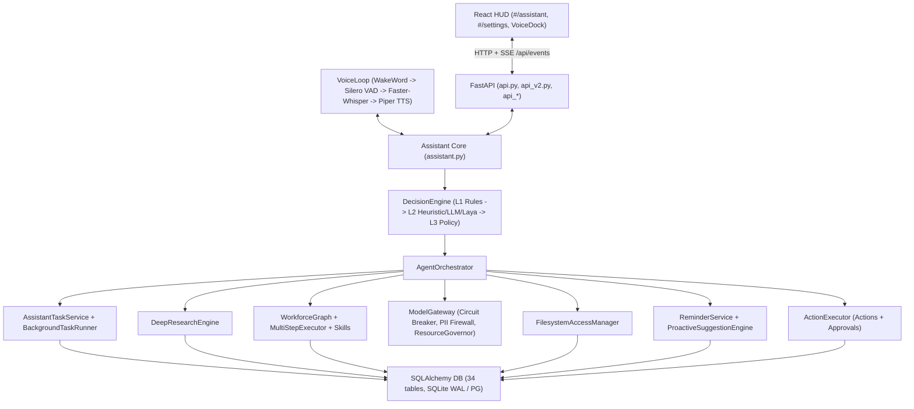

# JARVIS — P0–P6 Pre-Implementation Architecture Audit & Plan

**Audit Date:** 2026-11-12  
**Workspace:** `d:\projects\myjarvis`  
**Scope:** Full backend (`jarvis/`), persistence/migrations (`jarvis/db/`), frontend (`apps/frontend/`), tests (`tests/`), and dependencies (`pyproject.toml`, `requirements.txt`) prior to P0–P6 implementation.

---

## 1. Executive Summary & Constraints

JARVIS is a local-first, offline-by-default personal AI assistant running on **FastAPI + SQLAlchemy (SQLite WAL / PostgreSQL + pgvector) + LangGraph + React/TypeScript + Vite**.

### Preserved Runtime & Hardware Profile
- **Hardware target:** AMD Ryzen 5 5600H, NVIDIA GTX 1650 (4 GB VRAM), 16 GB RAM, Windows.
- **Preserved core components:**
  - Speech & Audio: Faster-Whisper (`jarvis/stt.py`, `jarvis/asr_providers.py`, `jarvis/audio_preprocess.py`), Piper TTS (`jarvis/tts.py`), Silero VAD (`jarvis/voice.py`), openWakeWord (`jarvis/wakeword.py`), WebRTC/NLMS AEC (`jarvis/aec.py`), `SpeechInspectorPanel.tsx`.
  - Model Routing & Security: `ModelGateway` (`jarvis/gateway/`), `FilesystemAccessManager` (`jarvis/filesystem_access.py`), `sys.addaudithook` outbound blocker (`jarvis/audit.py`), `netsec.py` pinned-IP HTTPS client, DPAPI secrets vault (`jarvis/security/secrets.py`), existing Dark HUD & Settings UX (`SettingsPanel.tsx`, `AudioVideoPanel.tsx`).
- **Architectural Rule:** **Zero competing engines.** Every P0–P6 capability extends existing subsystems (`AssistantTaskService` + `BackgroundTaskRunner`, `DeepResearchEngine`, `jarvis/skills/`, `ReminderService` + `ProactiveSuggestionEngine`, `ActionExecutor` + `ToolOutcome`, `OperationsDrawer` + HUD).

---

## 2. Measured Baseline Check Results (2026-11-12)

All baseline checks were executed before any P0–P6 edits:

| Check | Command | Baseline Result | Notes |
|---|---|---|---|
| **Backend Pytest** (non-live) | `.venv\Scripts\python.exe -m pytest -m "not live and not pg" -q -rs` | **257 passed, 2 skipped, 2 deselected** (360.11s) | 2 skipped (`test_p10_11_hardening.py:221`, `test_p10_12_hardening.py:165` — live Docker daemon not running on host) |
| **Frontend Unit Tests** | `npm test` (`node --test "src/**/*.test.ts"`) | **12 passed, 0 failed** (200.72ms) | Covers `graphCore`, `mediaDevices`, `speechStatus` |
| **Frontend Typecheck + Build** | `npm run build` (`tsc --noEmit && vite build`) | **Exit 0**, 47 modules transformed (1.08s) | `dist/assets/index-BG7dtOgg.js` (317.99 kB), `index-c9dVwR21.css` (25.72 kB) |
| **Python Lint (Ruff)** | `.venv\Scripts\python.exe -m ruff check jarvis tests` | **29 errors** (4 in `jarvis/`, 25 in `tests/`) | Pre-existing unused imports / `E741` / `F841` in untouched files |
| **Python Typecheck (Mypy)** | `.venv\Scripts\python.exe -m mypy jarvis` | **24 errors in 8 files** (checked 129 source files) | Includes real bugs at `assistant.py:835,1676`, `orchestrator.py:66`, `gateway.py:354`, `search.py`, `tts.py`, `aec.py`, `0005` migration |
| **Dependency Security** | `.venv\Scripts\python.exe -m pip_audit --local` | **Exit 0 — No known vulnerabilities found** | 35 pinned dependencies in `requirements.txt` |

---

## 3. Existing Codebase Inventory & Responsibilities

### 3.1 Backend (`jarvis/` + `config/` — 128 files)
- **API & Runtime:** `jarvis/api.py` (44 routes, SSE `/api/events`, security headers, host/X-Jarvis middleware), `jarvis/api_v2.py` (84 `/api/v2/*` routes), `jarvis/api_decision.py` (8 routes), `jarvis/api_skills.py` (15 routes), `jarvis/api_workspace.py` (23 routes), `jarvis/api_learning.py` (31 routes), `jarvis/api_deps.py` — **205 routes total**.
- **Orchestrator & Runtime Loop:** `jarvis/assistant.py` (`Assistant`), `jarvis/agents/orchestrator.py` (`AgentOrchestrator` wiring DB, 5-Way Memory, Approvals, `FilesystemAccessManager`, `AssistantTaskService`, `BackgroundTaskRunner`, `CommandHistoryService`, `MultiStepExecutor`, `ProjectRegistryService`, `DevWorkforceService`, `DocumentService`, `ReminderService`, `EmailDraftService`, `LocalCalendarService`, `DisasterRecoveryManager`, `SkillRegistryService`, `AgentCapabilityRouter`, `DecisionEngine`, `ModelGateway`, `DeepResearchEngine`, LangGraph workflows).
- **Config, Core, Security:** `jarvis/config.py` (`Settings` Pydantic specs, `load_settings`, `save_overrides`, `JARVIS_OVERRIDES_FILE`, `setup_logging`), `jarvis/core/{errors,event_bus,resources}.py`, `jarvis/security/{outcomes,untrusted,pii_firewall,secrets}.py`, `jarvis/audit.py`, `jarvis/netsec.py`.
- **Database & Migrations (`jarvis/db/`):** `engine.py` (`DatabaseManager`, SQLite WAL + PostgreSQL/pgvector support), `targets.py`, `models.py` (**34 ORM tables**), Alembic revisions `0001_initial_schema.py` through `0008_p11_command_history.py` (current head).
- **Task & Multi-Step Execution (`jarvis/agents/`):** `tasks.py` (`AssistantTaskService` backed by `AssistantTaskRow`), `task_runner.py` (`BackgroundTaskRunner`, `TaskRunContext`, `TaskExecutionResult`, `ToolOutcome` enforcement), `multistep.py`, `approvals.py`, `command_history.py`, `checkpointer.py`, `assistant_graph.py`, `workforce_graph.py` (12-state LangGraph DAG).
- **Research (`jarvis/agents/research.py`, `jarvis/search.py`):** `DeepResearchEngine` (7-stage PLAN → INVESTIGATE → REVIEW → WRITE → VERIFY → REVISE → EXPORT with SHA-256 disk snapshots and quote/claim verification), `WebSearchService`.
- **Skills & Capabilities (`jarvis/skills/`):** `SkillRegistryService`, `AgentCapabilityRouter`, `validate_skill_package`, `inspect_skill_security`, `discover_local_skills` (`.opencode/skills`, `.claude/skills`, `.agents/skills`), `inspect_runtime_compatibility`.
- **Scheduling & Proactive:** `jarvis/departments/assistant/reminders.py` (`ReminderService` + `ReminderRow`), `jarvis/proactive.py` (`ProactiveSuggestionEngine`), `APScheduler==3.11.3` installed in `.venv` / `requirements.txt` (currently unused).
- **Actions & Filesystem:** `jarvis/filesystem_access.py` (`FilesystemAccessManager`), `jarvis/actions.py` (`ActionExecutor`, `ACTION_REGISTRY`, `TaskManager`).

### 3.2 Frontend (`apps/frontend/src/` — 36 files)
- **Mounted Shell (`App.tsx`):** Strictly maps routes to two top-level views:
  - `#/assistant` (`AssistantHome.tsx`, `OperationsDrawer.tsx`, `SpeechInspectorPanel.tsx`, `BrainExplorer.tsx`, `GraphView.tsx`, `Inspector.tsx`)
  - `#/settings` (`SettingsPanel.tsx`, `AudioVideoPanel.tsx`)
  - Persistent `VoiceDock.tsx` + SSE `EventSource` client `live.ts` (`/api/events?since_seq=...`).
- **Existing Unmounted Panels in `src/features/` & `src/components/`:**
  - `WorkforcePanel.tsx`, `DecisionPanel.tsx`, `GatewayPanel.tsx`, `RecoveryPanel.tsx`, `AssistantPanel.tsx`, `SkillsPanel.tsx`, `LearningPanel.tsx`, `OverviewPanel.tsx`, `ChatPanel.tsx`, `JarvisCorePanel.tsx`.
- **Operations Drawer (`OperationsDrawer.tsx`):** Currently renders 5 tabs (`history`, `aliases`, `memory`, `desktop`, `system`); fetches `actionsReg.history` from `/v2/actions/registry` without rendering it.

---

## 4. Current Architecture & Data Flow

### Current Request / Execution Flow
1. User enters text or voice (`VoiceDock` -> `/api/chat/stream` or `VoiceLoop` -> `Assistant.stream_turn`).
2. Pending clarifications (`pending_clarification`) & L1 deterministic rules (`decision/rules.py`) check before L2 classification & L3 `DecisionEngine` routing.
3. For filesystem or multi-step requests, `FilesystemAccessManager` checks project aliases, grants, and temporary-path guards, raising `FilesystemPermissionRequestRow` + SSE `permission_requested` when unauthorized.
4. For deep research (`/api/v2/research` or routed research intent), `BackgroundTaskRunner` runs `DeepResearchEngine` asynchronously with checkpoints and SHA-256 snapshot persistence.
5. `Assistant._watch_reminders()` polls `ReminderService.poll_due()` every 15s and emits `reminder_due` over `EventBus` + TTS.
6. Live updates stream over `/api/events` (SSE) to `App.tsx`, `AssistantHome.tsx`, `VoiceDock.tsx`, and `graphStore.ts`.

---

## 5. Identified Gaps, Bugs & Architectural Risks (To Fix in P0–P6)

1. **Error Envelope & Correlation Logging Fragmentation (P0):**
   - `jarvis/core/errors.py` defines `JarvisError` and `ErrorEnvelope`, but `api.py` only emits `code` for `JarvisError`, while `api_v2.py` raises FastAPI `HTTPException` (`{"detail": ...}`).
   - `setup_logging()` in `config.py` uses plain text lines without structured JSON format option, correlation/request/task IDs (`contextvars`), or centralized secret/API-key redaction filters.
   - Pre-existing mypy bugs discovered at baseline:
     - `assistant.py:1676`: calls non-existent `AgentCapabilityRouter.select(...)` instead of `select_skills_for_task(...)`.
     - `assistant.py:835`: passes string `decision_layer` into `GatewayRequest` expecting `int`.
     - `assistant.py:894`: cloud gateway branch skips tool-calling loop, while local Ollama calls `self.brain` directly instead of unified `ModelGateway`.
2. **Task State Machine & Lifecycle Gaps (P1):**
   - `AssistantTaskService` lacks a single enforced transition validator (`validate_task_transition`), explicit `scheduled` and normalized `done` / `waiting` state parity with `P1` contracts, execution-time partial reports, task pause/resume API helpers, and steering delivery helpers across non-research background tasks (`orchestrator.py` only registers `deep_research` on `BackgroundTaskRunner`).
   - `AssistantHome.tsx` caps tasks at 8, hides budget/attempt/checkpoint fields, lacks status filter, pause/resume buttons, and steering UI even though `/v2/tasks/{id}/steer` and `/v2/tasks/{id}/resume` exist.
3. **Deep Research Source Verification & Local Folder Research Gaps (P2):**
   - `DeepResearchEngine` already verifies snapshots via SHA-256 and supports `verify_claims_against_snapshots`, **but**:
     - Quote matching relies on substring presence without structured claim-vs-quote/source-span provenance records, freshness scoring, or explicit unverified-claim exclusion/separation metrics exposed cleanly via `/v2/research/{task_id}`.
     - Local-folder research (querying files inside user-approved directories via `FilesystemAccessManager`) is not integrated as a first-class source type alongside KB chunks and `WebSearchService`.
     - Redirect chain / DNS-rebinding / prompt-injection isolation telemetry needs end-to-end verification tests and a dedicated **Research UI** in the HUD.
4. **Markdown Agent Profiles & Deterministic Delegation Missing (P3):**
   - `jarvis/skills/` handles `SKILL.md` skills, **not Markdown + YAML frontmatter Agent Profiles (`agents/*.md`)** loaded from built-in / user (`data/agents` / `~/.jarvis/agents`) / project (`.jarvis/agents`, `.claude/agents`, `.agents`) directories with schema validation, malformed-file diagnostic skipping, least-privilege tool allowlists, bounded delegation depth/fanout, and privilege-escalation isolation.
   - `AgentCapabilityRouter` method name mismatch (`assistant.py:1676`) breaks runtime skill routing.
5. **No Unified Routine Scheduler or Quiet Hours (P4):**
   - `ReminderRow.recurrence_cron` exists in schema, yet `ReminderService.poll_due()` never parses or reschedules recurring triggers.
   - No `RoutineRow` / `RoutineRunRow` DB persistence, no `APScheduler`-backed unified engine covering one-time / daily / weekly / monthly / interval (`every_n_minutes`) / startup / conditional triggers, no quiet-hours suppression/deferral, no late/missed/expired execution policy, no idempotency keys, and no Routines UI.
   - `ProactiveSuggestionEngine._dismissed_until` is RAM-only (lost on restart).
6. **Action Verification Bypasses & Missing Undo System (P5):**
   - `api_v2.py:493-496` (`/documents/parse`) bypasses `FilesystemAccessManager` via legacy `SafeFilesystem` and parses raw untrusted content without `<jarvis_untrusted_data>` wrapping.
   - `actions.py:644-653` (`keyboard_type`, `mouse_click`) return `ToolStatus.STARTED` / `executed: True` stubs without performing actual OS input or returning an honest unavailable/blocked outcome.
   - Zero `UndoJournal` DB model or reversible action snapshot capture (`create_file`, `modify_file`, `delete_file`, `move_file`, reminder/note mutations), zero expiry/state-mismatch guards, and zero `/v2/actions/undo` API or UI.
   - Unresolved security/duplication risk between `ActionExecutor._pending` (RAM) and `ApprovalService` (DB) and `/api/v2/actions/execute` verification outcomes (`ask`/`denied` parity).
7. **Fragmented HUD Operations Center & Unmounted Features (P6):**
   - 10 feature panels exist in `apps/frontend/src/features/` unmounted; `Inspector.tsx` buttons point to unreachable routes (`workforce`, `projects`, `skills`).
   - Need a cohesive **Operations Center** cleanly integrated into the existing HUD (`OperationsDrawer` / Operations Console view toggle inside HUD) covering **Overview, Tasks, Agents, Research, Routines, Actions (with History & Undo), and Gateway Controls**, while preserving the Hologram/Graph stage, VoiceDock, and Settings UX.

---

## 6. Phased P0–P6 Architecture & Migration Plan

### DB Migration Plan (`jarvis/db/migrations/versions/`)
- Current Alembic head: `0008_p11_command_history.py`.
- Planned incremental migrations (strictly additive & SQLite/PG compatible, plus `_reconcile_columns_sync` compatibility):
  - **`0009_p1_p4_tasks_routines.py`:** Add/reconcile task lifecycle & scheduling fields on `assistant_tasks` (`scheduled_for`, `pause_reason`, `partial_report`, `parent_task_id`, `correlation_id`), plus `routines`, `routine_runs`, and `proactive_dismissals` tables.
  - **`0010_p5_undo_journal.py`:** Add `undo_entries` and persistent `action_executions` audit/outcome history table (preserving existing 34 tables cleanly).

### Phase Execution Roadmap & Files

| Phase | Core Deliverables & Reuse Strategy | Primary Backend Files | Primary Frontend Files |
|---|---|---|---|
| **P0: Foundation** | Consolidated Pydantic domain contracts (`jarvis/core/contracts.py`) mirrored in `apps/frontend/src/contracts.ts`; contextvar correlation IDs (`correlation_id`, `task_id`, `routine_id`) + secret/token log redaction filter + optional JSON formatter in `jarvis/core/logging_ctx.py` & `config.py`; unified `ErrorEnvelope` across `api.py` & `api_v2.py`; fix mypy wiring bugs (`assistant.py:835,1676`); foundation test suite. | `jarvis/core/{contracts,logging_ctx,errors}.py`, `jarvis/config.py`, `jarvis/api.py`, `jarvis/api_v2.py`, `jarvis/assistant.py` | `apps/frontend/src/contracts.ts`, `apps/frontend/src/api/client.ts` |
| **P1: Background Task Engine** | Extend `AssistantTaskService` & `BackgroundTaskRunner` with enforced state-transition matrix (`queued`, `scheduled`, `running`, `waiting`, `waiting_quota`, `paused`, `done`, `failed`, `cancelled` + compatibility aliases), `pause_task` / `scheduled` due claiming, partial budget-exceeded reports, checkpointed protected-action revalidation, steering delivery in `TaskRunContext`, additional runner handlers (`multistep`, `routine`), Task pause/steer/resume endpoints. | `jarvis/agents/{tasks,task_runner,orchestrator,multistep}.py`, `jarvis/db/{models,engine}.py`, `jarvis/api_v2.py`, `0009_*` | `AssistantHome.tsx`, `OperationsCenter` Tasks tab |
| **P2: Deep Research Engine** | Extend `DeepResearchEngine` with structured claim-quote-source span verification, quote-match ratio, freshness & contradictions panel data, local-folder authorized research via `FilesystemAccessManager` + `parse_document_untrusted`, SSRF/redirect/private-IP verification tests, GET `/v2/research` list & `/v2/research/{task_id}` detail routes, Research UI tab. | `jarvis/agents/research.py`, `jarvis/netsec.py`, `jarvis/search.py`, `jarvis/api_v2.py` | `OperationsCenter` Research tab |
| **P3: Markdown Agent Profiles** | New `jarvis/agents/profiles.py` loading `.md` + YAML frontmatter agent definitions across built-in (`jarvis/agents/builtin_agents/`), user (`data/agents/`), and project (`.jarvis/agents/`, `.agents/`) directories; Pydantic schema validation + diagnostic skip errors (never crashes startup); deterministic backend agent & tool selection; bounded delegation depth/fanout & privilege non-escalation enforcement; `/v2/agents` API + Agents UI tab. | `jarvis/agents/profiles.py`, `jarvis/agents/builtin_agents/*.md`, `jarvis/skills/router.py`, `jarvis/assistant.py`, `jarvis/api_v2.py` | `OperationsCenter` Agents tab |
| **P4: Unified Routine Scheduler** | Unified `RoutineSchedulerService` (`jarvis/departments/assistant/routines.py`) using `APScheduler` trigger calculations + `ReminderService` convergence (zero duplicate loops); supports `once`, `daily`, `weekly`, `monthly`, `every_n_minutes`, `startup`, `conditional`; persistent quiet hours (`PreferencesSpec.quiet_hours`), late/missed/expired policies, idempotency keys per run slot, persistent proactive dismissals, `/v2/routines` API & Routines UI tab. | `jarvis/departments/assistant/{routines,reminders}.py`, `jarvis/proactive.py`, `jarvis/config.py`, `jarvis/db/models.py`, `jarvis/assistant.py`, `jarvis/api_v2.py` | `OperationsCenter` Routines tab |
| **P5: Verified Actions & Undo** | Unified 7-step execution pipeline (`VALIDATE -> AUTHORIZE -> CONFIRM -> EXECUTE -> VERIFY -> RECORD -> REPORT`) in `jarvis/actions.py` + `jarvis/security/outcomes.py` supporting `started`, `done`, `unverified`, `failed`, `ask`, `denied`; real Win32 verification or honest unavailable reporting (fixing `keyboard_type`/`mouse_click` stubs); fix `/v2/documents/parse` FS bypass; DB-backed `UndoService` (`jarvis/undo.py`) with reversible-only snapshots, external-modification conflict checks, expiry checks, `/v2/actions/{id}/undo` & Actions/Undo UI. | `jarvis/undo.py`, `jarvis/actions.py`, `jarvis/filesystem_access.py`, `jarvis/security/outcomes.py`, `jarvis/api_v2.py`, `jarvis/db/models.py`, `0010_*` | `OperationsCenter` Actions & Undo tab |
| **P6: Operations Center & E2E** | Unified Operations Center embedded in the HUD (`Overview`, `Tasks`, `Agents`, `Research`, `Routines`, `Actions`, plus existing `History`, `Aliases`, `Memory`, `System`, and `Gateway` controls); SSE reconnect/backfill sync across all tabs; non-blocking voice pipeline integration + routing tests; fix broken `Inspector.tsx` links; Playwright/live/API E2E Scenarios A–J. | `jarvis/api.py`, `jarvis/api_v2.py`, `jarvis/assistant.py` | `apps/frontend/src/App.tsx`, `OperationsDrawer.tsx`, `AssistantHome.tsx`, `Inspector.tsx`, new Operations Center subviews |

---

## 7. Risks, Mitigations & Testing Strategy

1. **Migration & Existing Test Compatibility:** Any DB schema changes must remain backward-compatible with tests that instantiate `DatabaseManager(tmp_db_url)` + `init_schema_sync()` without manually running `alembic upgrade`. **Mitigation:** Update ORM `Base.metadata` definitions AND add column reconciliation entries in `jarvis/db/engine.py::_P10_COLUMN_DDLS` alongside Alembic migrations.
2. **Event Loop Blocking:** Several existing DB calls inside `async` routes use `sync_session()`. **Mitigation:** Keep new services async (`async_session()`) or offload sync calls with `asyncio.to_thread` where sync callers exist.
3. **Settings & Test Isolation:** Never write test state to `data/settings.json`; continue honoring `JARVIS_OVERRIDES_FILE` and clean fixtures in `tests/conftest.py`.
4. **Testing Gate per Phase:**
   - Dedicated unit & integration tests per phase (`tests/test_p0_*.py` .. `tests/test_p6_*.py`).
   - Full non-live regression suite (`pytest -m "not live and not pg"`), `ruff check` on touched files (and monitor overall repo count), `mypy`, frontend `npm test`, and `npm run build` (`tsc --noEmit && vite build`) after every phase before advancing.

