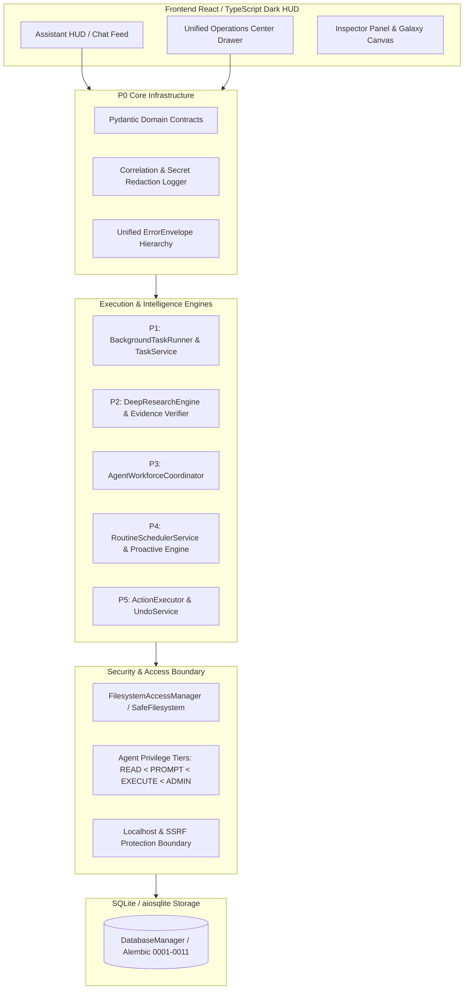

# JARVIS Target Architecture: Phases P0 through P6

## Executive Summary

JARVIS is a local-first, low-latency, privacy-preserving AI assistant engineered for Windows 11 desktop environments on consumer hardware (Ryzen 5 5600H, NVIDIA GTX 1650 4GB VRAM, 16GB RAM).

The P0–P6 architecture upgrade elevates JARVIS from an experimental conversational tool into a verified, resilient AI Operating System capable of:
1. Deterministic error handling, structured contracts, and secret-redacted logging (**P0**).
2. Reliable, checkpointed, resumable, and steerable durable background tasks (**P1**).
3. Grounded, evidence-based deep research with verbatim quote offset tracking, cross-source contradiction detection, and privacy-preserving local folder ingestion (**P2**).
4. Markdown-configured agent profiles with strict precedence, allowlist/denylist tool sandboxing, and bounded delegation without privilege escalation (**P3**).
5. A unified recurring, one-time, and conditional routine scheduler with APScheduler triggers, persistent quiet hours, and an idempotency journal (**P4**).
6. Honest action verification (`ToolOutcome`), zero-bypass filesystem security, and byte-for-byte reversible snapshots with external conflict detection (**P5**).
7. A unified Operations Center inside the React/TypeScript HUD with real-time SSE streaming, full status visibility, and robust inspection workflows (**P6**).

---

## High-Level System Architecture Diagram

---

## Component Matrix across Phases

| Phase | Core Module | Primary DB Tables | Main Endpoints | Key Guarantee |
|---|---|---|---|---|
| **P0** | `jarvis.core.contracts`, `jarvis.core.logging_ctx`, `jarvis.core.errors` | All tables | All `/api/v2/*` routes | Unified `ErrorEnvelope`, correlation propagation, secret-redacted logging |
| **P1** | `jarvis.agents.tasks`, `jarvis.agents.task_runner` | `assistant_tasks` (migration `0009`) | `/api/v2/tasks/*` | State machine validation, checkpointing, pause/resume, live steering, step/token/tool budgets |
| **P2** | `jarvis.agents.research` | `assistant_tasks` metadata | `/api/v2/research/*` | Verbatim quote offset spans `[start:end]`, provenance badges, cross-source contradiction detection, prompt injection boundary isolation |
| **P3** | `jarvis.agents.profiles` | File-based (`builtin`, `user`, `project`) | `/api/v2/agents/*` | YAML frontmatter validation, deterministic tool filtering, bounded delegation depth, privilege escalation blocking |
| **P4** | `jarvis.departments.assistant.routines`, `jarvis.proactive` | `routines`, `routine_runs`, `proactive_dismissals` (migration `0010`) | `/api/v2/routines/*`, `/api/v2/system/suggestions/*` | APScheduler cron/interval/startup/conditional triggers, overnight quiet hours suppression, restart-persistent dismissals |
| **P5** | `jarvis.undo`, `jarvis.actions`, `jarvis.departments.assistant.documents` | `undo_entries`, `action_executions` (migration `0011`) | `/api/v2/undo/*`, `/api/v2/actions/*`, `/api/v2/documents/parse` | Honest `ToolOutcome` verification, byte-level reversible snapshots, external conflict checks (`before_sha256`), safe document parsing |
| **P6** | `apps/frontend/src/components/OperationsDrawer.tsx`, `AssistantHome.tsx` | UI State & Live SSE Event Bus | `/v2/system/health`, `/v2/commands/history`, etc. | 10-tab Operations Center, active steering UI, undo triggers, real-time sync, zero frontend broken links |

---

## Hardware & Environment Alignment

- **Local-First / Offline Default**: Local execution requires zero external API dependencies. Gateway providers (Ollama, OpenRouter, Anthropic, Gemini, Groq) use secure vault credentials only when explicitly authorized by the user.
- **Resource Footprint**:
  - Task execution step limits default to 20 steps, preventing runaway agent loops.
  - Research pages are bounded to 4 local pages or 24 candidate files per search.
  - Snapshots are bounded by 86,400-second TTLs and cleaned up asynchronously.
  - Real-time CPU, RAM, and GPU telemetry alerts users before resources drop below safety thresholds (2.0 GB RAM, 3.0 GB VRAM).

