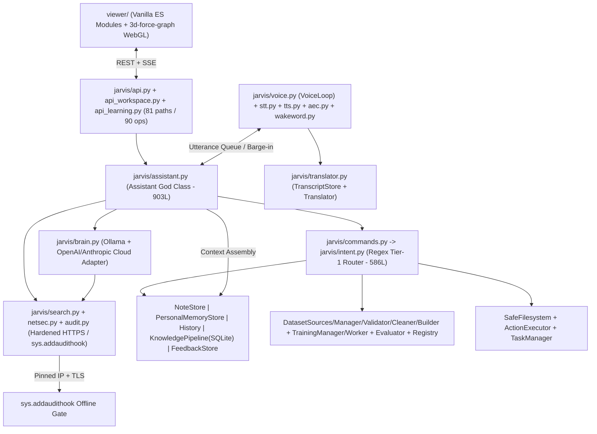

# 02 — Existing Architecture Assessment

> **Audit Basis**: Verified directly against repository source files on `d:\projects\myjarvis` (no source modifications performed).

---

## 1. High-Level Architectural Pattern

Jarvis is currently implemented as a **single-process Python FastAPI monolith** (`server.py` → `jarvis/api.py`) paired with a **vanilla ES-module single-page frontend** (`viewer/`) and **file-backed local persistence** (`notes/`, `data/`, `logs/`, `config.json`).

- **Runtime footprint**: Launches via `uvicorn jarvis.api:create_app --factory` bound strictly to `127.0.0.1:4700`.
- **Execution model**: Asynchronous FastAPI HTTP + Server-Sent Events (`EventSource` on `GET /api/events`, SSE streaming on `POST /api/chat/stream`), bridged to synchronous background worker threads (`VoiceLoop`, `Speaker`, `NoteStore` disk scans, `asyncio.to_thread(...)` calls).
- **Primary inference runtime**: Local Ollama HTTP server at `http://127.0.0.1:11434` (`qwen3:4b-instruct`, `qwen2.5vl:3b`, `qwen3:4b` verified installed via `ollama` & `/api/health`).
- **Speech & audio pipeline**: Local `faster-whisper` (`small`, CTranslate2 int8 CPU), `piper-tts` (`en_US-ryan-medium`, `en_US-amy-medium`), `openWakeWord` (`hey_jarvis.onnx` ONNX CPU), `sounddevice` (PortAudio), plus pure-NumPy NLMS Acoustic Echo Cancellation (`jarvis/aec.py`) with safe half-duplex mic suppression during TTS playback.

---

## 2. Structural Architecture Diagram

---

## 3. Core Startup & Initialization Flow

1. `server.py` (17 lines) runs `uvicorn.run("jarvis.api:create_app", factory=True, host=s.host, port=s.port, workers=1)`.
2. `jarvis/config.py`: `load_settings()` merges `config.json` (checked into git) with optional `data/settings.json` overrides via Pydantic v2 `Settings`. Separately reads `data/secrets.json` for API keys (`get_provider_api_key`).
3. `jarvis/api.py`: `create_app(settings)` installs `audit.install()` (`sys.addaudithook`), sets enforcement from `settings.offline_enforced` and `settings.internet.enabled`, instantiates a single `Assistant` (`app.state.a`), registers an `asynccontextmanager` lifespan that binds `a.loop`, runs `a.start()` (loading Whisper/Piper in background thread, warming Ollama, starting periodic note-watcher & knowledge-check asyncio tasks, auto-starting continuous mic loop when enabled), mounts `create_workspace_router(app.state.a)` and `create_learning_router(app.state.a)`, and mounts `viewer/` static assets.

---

## 4. End-to-End Request Execution Flows

### 4.1 Chat / Text Turn (`POST /api/chat`, `POST /api/chat/stream`)
1. `Assistant.stream_turn()` acquires `self._turn_lock` (an `asyncio.Lock` serializing all turns globally), calls `self.speaker.stop()`, sets activity `"thinking"`.
2. Calls `commands.route(self, text)` -> `intent.route_intent(self, text)` (30+ regex patterns for voice/model switch, notes/memory CRUD, history search, filesystem read/inspect, action confirm/reject, learning/training triggers, and auto-correction detection).
   - If matched: yields deterministic `meta` → `token` → `done`, logs to `History`, optionally calls `self.speaker.say(reply)`, and returns immediately without touching the LLM.
3. If unmatched: `_gather_context(text)` runs 5 synchronous retrievals sequentially on the turn path:
   - `NoteStore` TF-IDF (`jarvis/retrieval.py`), filtering `score >= 2.2`, fetching short follow-up context from previous user message when `< 4` words.
   - `PersonalMemoryStore.search(..., limit=3)` (`score >= 1.5`).
   - `History.search_disk(..., limit=4)` deduplicated against in-RAM window (`history.window()`).
   - `FeedbackStore.retrieve_lessons(..., limit=2)`.
   - `KnowledgePipeline.search(..., k=2)` (`score >= 2.0`).
4. `persona.build_messages(...)` packs system persona + provenance-labeled context blocks under `history_chars` / `context_chars` budgets.
5. **Local Mode (`online == False`)**: `_stream_llm_with_tts()` calls `Brain.stream_events()`, passes tokens through `StreamingSpeechBuffer` sentence chunking → `Speaker.say_chunk()`.
6. **Online Assisted Mode (`online == True`)**: passes `_web_tools` (`web_search`, optional `fetch_webpage`) to Ollama `/api/chat`; handles `ToolsUnsupportedError` or `needs_web_intent()` deterministic fallback via `WebSearchService.search()`, then streams final grounded answer + unique `web_sources`.
7. Appends user + assistant messages to `History` (`data/history.jsonl`).

### 4.2 Voice & Audio Pipeline (`VoiceLoop` → `Assistant`)
1. `VoiceLoop` (`jarvis/voice.py`, 832L) owns `AudioState` (`IDLE`, `LISTENING`, `PROCESSING`, `SPEAKING`, `PAUSED`, `INTERRUPTED`, `DISCONNECTED`, `ERROR`).
2. Captures 16 kHz / device-rate mic audio via `sounddevice`, detects speech boundaries via `_StreamingSileroVAD` / energy RMS + pre-roll/hangover thresholds.
3. Supports three modes: `continuous`, `ptt` (push-to-talk), and `wake_word` (`openwakeword`).
4. **Echo & Feedback Prevention**: Safe Half-Duplex mode (`suppress_mic_during_tts=true` default) closes/suspends mic capture while `Speaker` plays Piper audio (`_on_speaker_state` hook). Full-duplex barge-in (`barge_in_enabled=true` optional) stays gated until `NLMSEchoCanceller` measures ERLE >= 8.0 dB (`verified == True`).
5. Completed utterances push `(utt_id, audio_f32)` into `utterance_queue`, wake `_drain_voice_queue()` → `Whisper.transcribe()` → `Translator.process_stt()` (optional correction + explicit translation while preserving `original_transcript`) → `stream_turn(speak=True, source="voice")` → `Speaker.wait_idle(120)` → `VoiceLoop.complete_turn()`.

### 4.3 Outbound Security & Network Isolation
1. At startup, `audit.install()` registers a Python `sys.addaudithook` intercepting `socket.connect` and `socket.getaddrinfo`.
2. In default **Local Mode**, any non-loopback connection raises `ConnectionError`.
3. In **Online Assisted Mode**, enforcement remains globally ON; only contexts inside `with audit.allow_outbound(hosts=..., ips=..., ports=..., purpose=...):` may connect.
4. `jarvis/netsec.py` validates HTTPS + port 443 only, rejects private/link-local/CGNAT/reserved IPs, pins resolved public IPv4 inside `_PinnedAsyncBackend` / `httpcore.AsyncConnectionPool` (eliminating DNS rebinding), disables `follow_redirects` (manually re-validating every hop up to `max_redirects`), strips sensitive query keys when logging to `logs/external_audit.jsonl`, and enforces response byte caps (`max_fetch_bytes`).

---

## 5. Identified Architectural Weaknesses

| Weakness Category | Exact Observation & Evidence | Impact on Future Vision (Multi-Agent AI OS) |
| :--- | :--- | :--- |
| **God Object (`Assistant`)** | `jarvis/assistant.py` (903L) constructs and directly mutates 20+ subsystems (`NoteStore`, `PersonalMemoryStore`, `SafeFilesystem`, `ActionExecutor`, `Brain`, `History`, `KnowledgePipeline`, `FeedbackStore`, `TrainingManager`, `ModelEvaluator`, `ModelRegistry`, `Whisper`, `PiperTTS`, `Speaker`, `VoiceLoop`, `WakeWord`, `WebSearchService`, `Translator`, `EventBus`) and mixes turn execution, RAG formatting, voice queue draining, and training helpers. | Impossible to swap storage backends, isolate Personal Assistant vs Dev Workforce execution planes, or unit-test orchestration without full hardware/disk fixtures. |
| **Global Mutable Singletons** | `jarvis/audit.py` holds module-level `_state`, `_events`, `_external_log`; `jarvis/tts.py` holds `_VOICE_POOL`; `jarvis/sysinfo.py` caches GPU/CPU in module dicts; `jarvis/learning/*` imports module-level path constants (`REGISTRY_PATH`, `TRAINING_DIR`). | Blocks concurrent isolated agent runs, multi-project contexts, and clean dependency injection in tests/workers. |
| **Router Closure Coupling** | `jarvis/api.py` passes `app.state.a` directly by argument to `create_workspace_router(app.state.a)` and `create_learning_router(app.state.a)` instead of FastAPI `Depends()`. | Replacing `app.state.a` dynamically after app creation leaves sub-routers bound to the stale `Assistant` instance. |
| **Monolithic Regex Dispatcher** | `jarvis/intent.py` (586L) chains 30+ top-to-bottom regex patterns plus hardcoded domain lookups (`a.store`, `a.memory_store`, `a.actions`, `a.training_manager`) returning heterogeneous dicts. | Fragile ordering conflicts (e.g., `VOICE_SWITCH` must precede `SWITCH_MODEL`), zero confidence scoring, no LLM Layer-2 intent disambiguation, and cannot route multi-agent or coding workflows. |
| **Dual Unsynchronized Memory Models** | Both Markdown `NoteStore` (`notes/*.md`, integer list-index IDs) and `PersonalMemoryStore` (`data/memory/records.jsonl`, UUID-like hex IDs) exist side by side. `REMEMBER` in `intent.py` dual-writes to both without transactional consistency; `/api/memory` and `/api/memory/items` expose split views. | Causes drift, duplicate recall results, unstable numeric note IDs across filesystem rescans, and conflicts with the 5-way Memory Separation target. |
| **Event-Loop Blocking Calls** | Inside `async def stream_turn` and `api_learning.py` / `api_workspace.py`, synchronous SQLite queries, file scans (`rglob`), JSONL rewrites, and `os.stat` loops run on the asyncio event loop thread. | Stalls SSE heartbeats, streaming audio, and concurrent requests under heavy repo scans or large KB searches. |
| **Hardware Resource Tightness** | Measured on host: `15.35 GB` RAM (`1.05 GB` free with server + desktop apps), GTX 1650 `4 GB` VRAM, Ryzen 5 5600H. Running Whisper + Piper + openWakeWord + Qwen 4B leaves almost zero margin for heavyweight sidecar DBs or Docker stacks alongside local inference. | Strongly favors a **Modular Monolith** over multi-container microservices, and `PostgreSQL + pgvector` over running separate Qdrant + Neo4j + worker containers on the same laptop. |
| **Stale Documentation** | `README.md` (lines 38–41) & `DOCUMENTATION_ANALYSIS.md` still contain pre-upgrade statements (`no cloud model`, `no web research`, `OLLAMA_HOST=0.0.0.0`) that contradict current code and verified loopback `127.0.0.1:11434`. | Misleads operators and contributors on true capabilities and security posture. |

---

## 6. Architecture Decision: Modular Monolith vs Microservices

For Jarvis’s hardware profile (15.35 GB system RAM, 4 GB GTX 1650 VRAM, single-user localhost workstation) and real-time voice/streaming latency needs:

- **Microservices are REJECTED**: Splitting Voice, RAG, Agents, Gateway, and Training into separate networked microservices would add IPC serialization overhead, duplicate in-memory buffers/models, consume critical RAM for multiple Python runtimes/brokers, and complicate Windows desktop startup (`start-jarvis.ps1`).
- **Modular Monolith is RECOMMENDED**: Keep one FastAPI backend (`apps/backend`) organized into strict internal vertical slices (`gateway/`, `decision/`, `orchestration/`, `agents/`, `departments/assistant/`, `departments/dev/`, `integrations/`, `memory/`, `learning/`, `voice/`, `recovery/`, `security/`) communicating through typed interfaces and an internal event bus, with isolated subprocess execution *only* for untrusted/heavy external CLIs (`opencode`, `graphify`, `training_worker.py`, `git` worktree ops) and optional managed PostgreSQL (+ `pgvector`).
