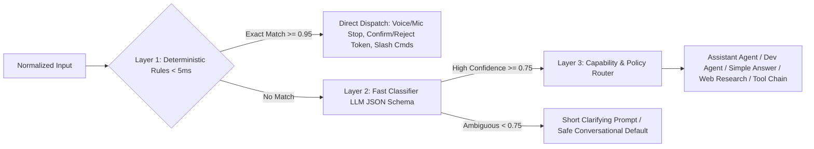

# 07 — Fast Decision Engine & Multi-Model Gateway Audit

> **Current Reality**: Jarvis currently has regex-only routing (`jarvis/intent.py` + `assistant.needs_web_intent`), a local Ollama stream client (`jarvis/brain.py`), and non-streaming HTTPS request helpers for `openai:` / `anthropic:` (`Brain._cloud_complete`). There is **no structured fast classifier**, **no OpenRouter / HuggingFace / Google Gemini / OpenCode provider adapter**, **no rate/token accounting**, and **no task-class model routing**.

---

## 1. Current Routing & Brain Implementation Gaps

| Capability | Current Implementation | Observed Limitation |
| :--- | :--- | :--- |
| **Intent Detection** | `jarvis/intent.py` (586L, 30+ regexes) + `assistant.needs_web_intent()` | Deterministic commands break on slight phrasing variations; non-matching complex tasks fall straight to the default chat model (`qwen3:4b-instruct`). |
| **Ollama Runtime** | `Brain` (`jarvis/brain.py`) talks to `127.0.0.1:11434`, filters `<think>`, supports tool calling & `unload()` on switch. | Manual switch only; cannot run lightweight fast router model (`qwen3:4b`) separately from coding/vision (`qwen2.5vl:3b`) per request without unloading/thrashing VRAM (`4 GB`). |
| **Cloud Adapters** | `Brain._cloud_complete()` supports `"openai:"` and `"anthropic:"` prefixes gated behind `providers.allow_cloud` + `internet.enabled` + `netsec.safe_request`. | Non-streaming single-shot HTTP response; no OpenRouter, Hugging Face Inference Providers, Google Gemini AI Studio API, or OpenCode provider proxy; no retries/backoff or token cost telemetry. |
| **Multilingual Awareness** | Whisper detects `ml` / `hi` / `en`, `Translator` translates/corrects. | Downstream TF-IDF (`jarvis/retrieval.py`) strips non-ASCII characters (`[a-z0-9]+`), causing zero retrieval hits for Malayalam queries across notes/memory/KB. |

---

## 2. Target 3-Layer Fast Decision Engine

Replace the monolithic `intent.py` `if/elif` chain with `backend/decision/engine.py` implementing three strict deterministic → probabilistic stages targeting `< 5ms` (Layer 1) and `< 150–400ms` (Layer 2 local):



### Layer 1 — Deterministic Fast Path (`< 5 ms`)
- Handles latency-critical hardware and safety controls without touching any LLM:
  - Audio stop/interrupt/pause/resume/mute (`STOP`, `PAUSE_VOICE`, `RESUME_VOICE`, `PTT`).
  - Explicit action/feedback confirmation tokens (`confirm action <tok>`, `reject action <tok>`).
  - Exact slash commands (`/mode`, `/project`, `/model`, `/status`, `/backup`).
  - Direct memory write prefixes (`remember: ...`, `forget memory <id>`).

### Layer 2 — Fast Classifier Model (Structured JSON Output)
- Invokes a fast local/free classifier (e.g., `qwen3:4b-instruct` with `think=false`, max 120 tokens, Ollama `format: json` schema, or Groq/Gemini Flash-Lite when explicitly enabled in Online Mode).
- Emits constrained JSON DTO `DecisionEnvelope`:
  - `department`: `"personal_assistant" | "dev_workforce" | "system_control" | "chat"`
  - `intent`: string (e.g., `"web_research"`, `"generate_pdf"`, `"code_fix"`, `"repo_explain"`, `"memory_recall"`, `"email_draft"`)
  - `complexity`: `"trivial" | "standard" | "complex_reasoning" | "heavy_coding"`
  - `needs_live_web`: bool
  - `needs_project_context`: bool + optional `project_hint`
  - `risk_tier`: `"READ" | "WRITE" | "EXECUTE"`
  - `confidence`: float (`0.0..1.0`)
  - `clarifying_question`: string | null

### Layer 3 — Capability-Aware Router & Fallback Matrix
- Maps `(department, complexity, risk_tier, internet.mode, free_vram_gb, quota_state)` to an exact execution plan + model selection:
  - **Rule 1 (Offline Invariant)**: If `offline_enforced` / `Local Mode`, cloud routes are hard-blocked (`NetworkSecurityError`) before dispatch and degrade gracefully to local Ollama.
  - **Rule 2 (Single-Resident GPU Awareness)**: On GTX 1650 `4 GB` VRAM, avoid swapping large models mid-conversation; route heavy coding/reasoning to remote API (OpenRouter/Gemini/Anthropic/OpenCode) when in `Online Assisted Mode` or queue cleanly locally.
  - **Rule 3 (Fallback Chain)**: E.g., `Coding (Primary: openrouter/qwen3-coder or anthropic)` → `Fallback 1: opencode configured provider` → `Fallback 2: local ollama qwen3:4b-instruct`.

---

## 3. Target Unified Model Gateway Architecture

Design `backend/gateway/` with a strict provider interface (`ModelProvider` ABC):

### Standardized Interface
```python
class ModelProvider(Protocol):
    name: str
    def capabilities(self) -> ProviderCapabilities: ...  # streaming, tools, vision, max_ctx, json_mode
    async def health(self) -> ProviderHealth: ...
    async def stream(self, req: GatewayRequest) -> AsyncIterator[GatewayEvent]: ...
```

### Supported Provider Adapters
1. **`OllamaAdapter` (Local Primary)**: Loopback-only (`127.0.0.1:11434`), preserves `ThinkFilter`, native tool-call extraction, model warm/unload telemetry, local embeddings (`/api/embeddings`).
2. **`OpenRouterAdapter` (Cloud Aggregator)**: `https://openrouter.ai/api/v1/chat/completions` via `netsec.safe_request` (streaming SSE extension to `netsec`), free-tier + paid models, `HTTP-Referer`/`X-Title` headers, per-model cost lookup.
3. **`HuggingFaceAdapter` (HF Inference Providers)**: `https://router.huggingface.co/v1/chat/completions` via `netsec`, gated by allowlist `huggingface.co` / `router.huggingface.co`.
4. **`GeminiAdapter` (Google AI Studio Free/Paid Tier)**: `https://generativelanguage.googleapis.com/v1beta/models/...` via `netsec` (`x-goog-api-key` header rather than `?key=` query param to prevent URL secret leakage!).
5. **`OpenAIApiAdapter` & `AnthropicAdapter`**: Upgraded from existing `_cloud_complete` to support SSE streaming, tool calling, usage metadata, and retry-with-jitter.
6. **`OpenCodeProviderBridge`**: Delegates coding-agent turns directly to local `opencode run --format json` / `opencode serve`, reusing OpenCode’s authenticated provider pool without duplicating credentials in Jarvis when preferred.

### Gateway Cross-Cutting Controls
- **Rate Limiting & Quota Guard**: Per-provider token-bucket RPM + daily token/dollar soft & hard budgets persisted in `llm_usage_logs`.
- **Resilient Retries**: Bounded exponential backoff on HTTP `429`/`502`/`503` (never retry `400`/`401`/`403`/policy blocks).
- **Prompt Budget & Secret Redaction Pre-Flight**: Before ANY external provider call leaves `netsec`, pass message text through `pii_firewall.redact_secrets()` so API keys or local secrets in retrieved files/memories NEVER leave the machine.
- **Explicit Egress Host Allowlist Update Required**: Target hosts (`openrouter.ai`, `router.huggingface.co`, `generativelanguage.googleapis.com`, `api.openai.com`, `api.anthropic.com`) must be added cleanly to configurable `ProvidersSpec` allowlists and remain 100% blocked in `Local Mode`.
