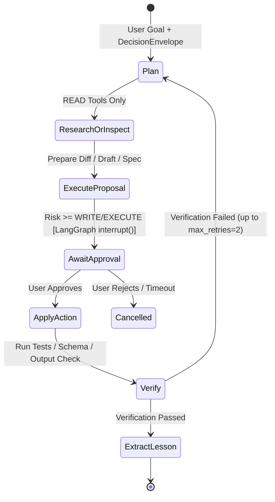

# 08 — Multi-Agent System, LangGraph & Document Engine Audit

> **Current Reality**: Jarvis currently has **zero multi-agent abstractions**, **zero `langgraph`/`langchain` packages installed**, **zero document export libraries (`reportlab`/`python-docx`/`python-pptx`/`openpyxl`)**, and **no email/calendar/reminder integrations**. All requests flow through a single `Assistant.stream_turn()` coroutine using either Ollama tool calls (`web_search`, `fetch_webpage`) or direct single-turn generation.

---

## 1. Department & Agent Decomposition

Splitting responsibilities into two coordinated departments eliminates the 903-line `Assistant` bottleneck and assigns least-privilege toolsets + models per agent role:

### Department A — Personal Assistant Agents
| Agent Role | Ownership | Allowed Tools (Scoped) | Preferred Model Class |
| :--- | :--- | :--- | :--- |
| **`assistant_coordinator`** | Triage personal requests, decompose multi-step personal workflows | `memory_read`, `note_crud`, `task_manage` | Fast Local / Balanced |
| **`research_agent`** | Online web research, source synthesis, citation verification | `web_search`, `fetch_webpage` (Online Mode only), `kb_search` | Reasoning / Long-Ctx |
| **`knowledge_curator`** | File/document QA, PDF/Word/Markdown ingestion, note linking | `fs_read`, `doc_parse`, `note_write`, `vector_upsert` | Balanced Local |
| **`document_producer`** | Generate formatted **PDF**, **DOCX**, **PPTX**, **XLSX**, Markdown exports | `doc_render_*` (writes only to approved output folder) | Structured / Coding |
| **`productivity_agent`** | Tasks, reminders, email triage/drafting, calendar scheduling | `task_repo`, `reminder_repo`, `email_adapter` (WRITE-gated send!), `calendar_adapter` | Fast / Balanced |

### Department B — AI Development Workforce Agents
| Agent Role | Ownership | Allowed Tools (Scoped) | Preferred Model Class |
| :--- | :--- | :--- | :--- |
| **`architect_agent`** | Multi-project system architecture, Graphify queries, blast-radius analysis | `graphify_query`, `graphify_affected`, `repo_read`, `project_memory` | Reasoning Model |
| **`coder_agent`** | Feature implementation & bug fixes inside isolated Git worktrees | `opencode_run`, `git_worktree_diff`, `fs_read/write` (worktree-jailed) | Coding Model / OpenCode |
| **`db_engineer_agent`** | Schema design, SQLAlchemy/Alembic migrations, query plan audit | `repo_read`, `alembic_preview`, `migration_write` (approval gated) | Coding / Reasoning |
| **`qa_verifier_agent`** | Execute pytest/vitest/linters/builds, inspect logs, block unverified claims | `run_verified_tests`, `git_diff_read` | Fast Coding / Deterministic |
| **`devops_reviewer_agent`** | Security scan, Dockerfile/scripts, PR review summary, merge readiness | `security_scan`, `git_status`, `worktree_merge` (**EXECUTE-gated**) | Reasoning Model |

---

## 2. LangGraph Orchestration Design

Why LangGraph fits Jarvis cleanly inside the Modular Monolith (once installed alongside PostgreSQL):
1. **Stateful Multi-Step Execution**: Replaces ad-hoc loops and volatile `TaskManager` RAM dicts with deterministic `StateGraph` execution backed by `langgraph-checkpoint-postgres` (`PostgresSaver`).
2. **Native Human-in-the-Loop Pause/Resume (`interrupt()`)**:
   - Currently `ActionExecutor` issues a 600s token in RAM and forces the caller to re-invoke the endpoint manually (`confirmed_token`).
   - With LangGraph `interrupt_before` / `interrupt()` on any `WRITE` or `EXECUTE` tool node (sending an email, applying destructive file overwrites, running migrations, merging worktrees, starting LoRA training), the graph serializes state atomically to PostgreSQL, pushes an SSE `approval_required` card to React, **suspends zero CPU/RAM while waiting**, and resumes cleanly across server restarts when approved!
3. **Runaway Prevention Guardrails**:
   - Mandatory `max_steps` (`recursion_limit`), `max_wall_seconds`, `max_token_budget` per `AgentRun`, plus cycle/repeat-tool detection (`same_tool_same_args > 2` → escalate to user).
4. **Telemetry Streaming**: Every LangGraph node transition publishes structured events (`run_started`, `node_entered`, `tool_called`, `approval_pending`, `run_completed`) onto `EventBus` → SSE for the React Workforce Console and optional spoken concise voice progress summaries.

---

## 3. Document Understanding & Generation Engine (Missing Today)

Currently `jarvis/filesystem.py::read_document` reads only plain UTF-8 text (`txt/md/py/json/...`). To achieve the Personal Assistant vision, add `backend/departments/assistant/documents/`:

| Format | Read / Parse Dependency (Recommended) | Generate / Export Dependency (Recommended) | Key Architectural Requirements |
| :--- | :--- | :--- | :--- |
| **PDF** | `pypdf` or `pymupdf` (`fitz` — fast, offline C-binding) | `reportlab` (pure Python, clean offline tables/charts) or WeasyPrint | Parse page numbers/headings into `personal_documents` chunks; render structured `ReportSpec` JSON → styled PDF inside sandboxed `output/documents/`. |
| **Word (.docx)** | `python-docx` | `python-docx` | Extract paragraphs/tables for RAG; generate templated reports with headings/lists/tables. |
| **PowerPoint (.pptx)** | `python-pptx` | `python-pptx` | Extract slide titles + speaker notes; generate slide decks from structured `SlideDeckSpec` (bullet budgets + notes). |
| **Excel / CSV (.xlsx)** | `openpyxl` + `pandas` | `openpyxl` | Bounded row previews & summary stats (`shape`, column dtypes) so LLM never chokes on 100k-row sheets; generate multi-sheet workbooks + formulas safely (sanitize `=cmd\|...` spreadsheet formula injection!). |

---

## 4. Personal Productivity Integrations (Email, Calendar, Reminders)

All absent in current repo; design cleanly behind interface ports in `backend/integrations/`:
- **Reminders / Scheduled Jobs**: Built locally first using PostgreSQL `reminders` table + APScheduler/asyncio timer wheel emitting SSE & voice notifications (**no external cloud required**).
- **Email & Calendar**: Abstract behind `EmailProvider` (`IMAP/SMTP` local-friendly or OAuth Gmail/Graph when explicitly opted into `Online Mode`) and `CalendarProvider` (`CalDAV` / `.ics` local + Google Calendar). Reading/summarizing = `READ`; creating drafts = `SAFE_WRITE`; **sending email or modifying shared calendar invites = `SENSITIVE/EXECUTE` explicit user confirmation always**.
