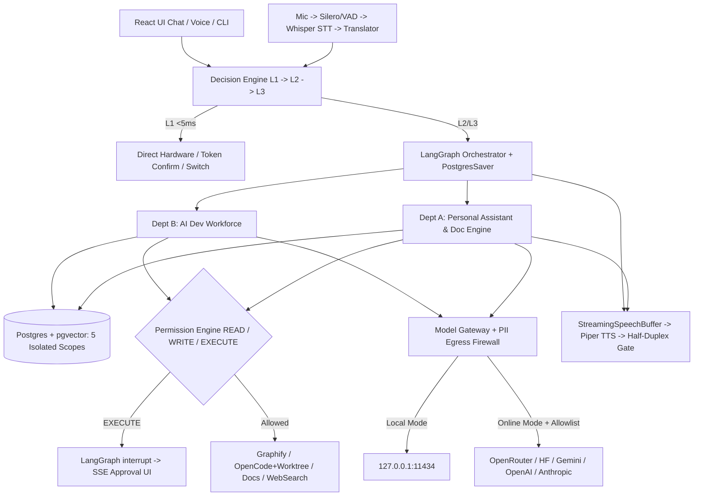

# 14 — Target Architecture Blueprint (Evaluated Modular Monolith)

> **Design Decision**: Adapt the multi-agent target layout into a **Modular Monolith** optimized for Jarvis's real-time voice loop, single-process `EventBus`, GTX 1650 `4 GB` VRAM, and `15.35 GB` RAM envelope—eliminating unnecessary microservice/broker overhead while establishing crisp module boundaries and isolated external tool sandboxes.

---

## 1. Proposed Repository Structure

```text
d:\projects\myjarvis\
├── apps/
│   ├── backend/
│   │   ├── main.py                      # Uvicorn bootstrap, lifespan, signal cleanup
│   │   └── cli.py                       # Admin CLI: db migrate, dr backup/verify, preflight
│   └── frontend/                        # Vite + React + TypeScript (bundled locally, zero CDN)
│       ├── public/vendor/               # Local fonts + 3d-force-graph offline assets
│       └── src/
│           ├── api/                     # Typed REST + SSE client generated from OpenAPI
│           ├── features/
│           │   ├── chat/                # Streaming answers, source badges, doc download cards
│           │   ├── voice/               # Continuous/PTT/Wake HUD, AEC telemetry, transcript editor
│           │   ├── galaxy/              # Memoized WebGL 3D knowledge & codebase graph island
│           │   ├── workforce/           # LangGraph runs, OpenCode logs, Git diffs, Approval queue
│           │   ├── memory/              # 5-way Memory explorer (Personal/Project/Experience/KB/Training)
│           │   └── recovery/            # 3-2-1 backups, manifest verifier, restore wizard
│           └── stores/
├── backend/
│   └── jarvis/
│       ├── config/                      # Pydantic settings, env layering, DPAPI/AEAD secrets
│       ├── api/
│       │   ├── app.py                   # FastAPI app factory, error envelope, security middleware
│       │   ├── deps.py                  # FastAPI Depends() container (no global closure binding)
│       │   └── routers/                 # v1 compat shims + v2 typed routers (chat, voice, memory,
│       │                                # files, projects, workforce, learning, dr, system)
│       ├── core/
│       │   ├── event_bus.py             # Typed async pub/sub bridging LangGraph/Voice -> SSE
│       │   ├── errors.py                # Canonical domain exception hierarchy
│       │   └── telemetry.py             # Token/VRAM/RAM/latency observability + sysinfo
│       ├── decision/                    # 3-Layer Fast Decision Engine
│       │   ├── rules.py                 # Layer 1: Deterministic <5ms controls & token confirmers
│       │   ├── classifier.py            # Layer 2: Structured JSON fast intent classifier
│       │   └── router.py                # Layer 3: Capability/Offline/Budget model & workflow router
│       ├── gateway/                     # Unified Multi-Model Gateway
│       │   ├── interface.py             # ModelProvider ABC + GatewayRequest/Event DTOs
│       │   ├── gateway.py               # Retry, RPM/budget guard, fallback chain, ThinkFilter
│       │   └── providers/
│       │       ├── ollama.py            # Local 127.0.0.1:11434 + embeddings
│       │       ├── openrouter.py
│       │       ├── huggingface.py
│       │       ├── gemini.py
│       │       ├── openai_api.py
│       │       ├── anthropic_api.py
│       │       └── opencode_bridge.py   # OpenCode provider session delegation
│       ├── agents/                      # LangGraph Multi-Agent Runtime
│       │   ├── state.py                 # Shared & scoped AgentState TypedDicts
│       │   ├── checkpointer.py          # PostgresSaver checkpoint persistence + interrupt/resume
│       │   ├── assistant_graph.py       # Research, Document, Knowledge & Productivity workflow
│       │   └── workforce_graph.py       # Architect -> Worktree -> Coder -> QA -> Review workflow
│       ├── departments/
│       │   ├── assistant/               # Notes, reminders, doc ingest/export (PDF/DOCX/PPTX/XLSX),
│       │   │                            # email/calendar ports, personal search
│       │   └── dev/                     # Project registry, coding supervisor, test runner, PR reviewer
│       ├── integrations/
│       │   ├── graphify_adapter.py      # graphify 0.9.80 CLI update/query/affected/god-nodes
│       │   ├── opencode_adapter.py      # opencode 1.19.5 headless run/serve + worktree sandbox
│       │   ├── git_worktree.py          # Isolated worktree lifecycle, diff, safe merge
│       │   └── web_search.py            # Hardened DuckDuckGo/Tavily/Brave/Serper/SearXNG + fetch
│       ├── memory/                      # Strict 5-Way Memory + Repositories
│       │   ├── db/                      # Async SQLAlchemy engine, Alembic migrations, pgvector
│       │   ├── repositories/            # Personal, Project, Experience, Knowledge, Conversation, Audit
│       │   ├── hybrid_retriever.py      # Unicode lexical + pgvector cosine + RRF merger
│       │   └── legacy_migrator.py       # Idempotent JSONL/SQLite -> Postgres importer
│       ├── learning/                    # Datasets, validation, cleaning, training worker, eval, registry
│       ├── voice/                       # VoiceLoop, Silero/energy VAD, Whisper STT, Piper TTS, NLMS AEC,
│       │                                # Translator (persistent transcript repo)
│       ├── recovery/                    # 3-2-1 backups, AEAD secret vault, SHA-256 manifests, verify drill
│       └── security/
│           ├── egress_guard.py          # sys.addaudithook loopback/allowlist gate
│           ├── http_client.py           # netsec SSRF/IP-pinned HTTPS transport (+ SSE streaming)
│           ├── pii_firewall.py          # Outbound secret/PII scanner before external calls
│           ├── permissions.py           # Unified READ / WRITE / EXECUTE policy + approval service
│           └── sandbox.py               # Subprocess env sanitization + project/worktree path jails
├── configs/                             # default.json, profiles (local_only.json, online_assisted.json)
├── deploy/                              # docker-compose.db.yml (optional local PostgreSQL + pgvector)
├── docs/
│   ├── audit/                           # Current architecture & migration blueprint (01..18)
│   └── archive/                         # Superseded phase notes & prompt packs
├── legacy/
│   └── viewer/                          # Preserved vanilla UI fallback during React rollout
├── scripts/                             # setup/bootstrap.ps1, migrate, preflight, drill, benchmarks
└── tests/                               # unit/, integration/, security/, e2e/ (pytest + vitest)
```

---

## 2. Clean Target Data Flow



---

## 3. Why This Structure Avoids Unnecessary Complexity

1. **Zero Distributed Queue Broker (No Redis/Celery/Kafka Required Initially)**: Asyncio + LangGraph Postgres checkpoints + bounded thread/subprocess pools handle multi-step background tasks and training/coding subprocesses cleanly inside one process while preserving RAM on a 16 GB laptop.
2. **Optional Single-Container PostgreSQL + `pgvector`**: Replaces SQLite + 6 disparate JSON/JSONL files with one ACID engine that natively stores relational state, LangGraph checkpoints, full-text `tsvector`, and isolated vector collections—requiring minimal background RAM compared to running Postgres + Qdrant + Redis separately.
3. **Zero Rewrites of Proven Subsystems**: `voice.py`, `stt.py`, `tts.py`, `aec.py`, `audit.py`, `netsec.py`, `search.py`, `dataset_*`, `training_worker.py`, `evaluation.py`, and `model_registry.py` retain their battle-tested internals while gaining clean package locations, DI interfaces, and Postgres-backed state.
