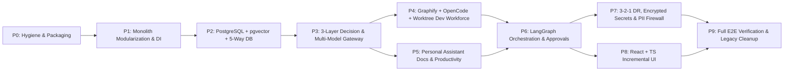

# 16 — Phased Implementation Roadmap (P0 – P9)

> **Execution Principle**: Zero "big-bang rewrite". Every phase leaves Jarvis **running, voice-capable, Local-Mode safe, and verified by `pytest`** before moving to the next phase.

---

## Phase Overview & Critical Path

---

### **Phase P0 — Immediate Repo Hygiene, Packaging & Baseline Safety**
- **Scope**: Strip UTF-8 BOM from `requirements.txt`, add missing direct deps (`pydantic`, `scipy`, `requests`), clean untracked `.playwright-mcp/` temp captures, archive root prompt PDFs to `docs/archive/`, fix stale statements in `README.md`, configure `ruff` + `mypy` + `pip-audit` baselines, add LRU cap to `data/tts_cache/`, fix side-effect write on `GET /api/learning/overview`.
- **Tests / Criteria**: `pip check` zero errors, `ruff check` + `pytest -v` (`132 passed`).

### **Phase P1 — Backend Boundary Extraction & Dependency Injection**
- **Scope**: Move/split `jarvis/assistant.py` (903L) into clean services (`EventBus`, `TurnService`, `VoiceCoordinator`) plus abstract repository ports (`NoteRepo`, `MemoryRepo`, `HistoryRepo`, `KnowledgeRepo`, `FeedbackRepo`, `TaskRepo`, `AuditRepo`) keeping current file stores as adapters. Replace `api.py` router closure capture with `Depends()`. Unify `/api/memory` & `/api/memory/items`. Assign persistent UUIDs to notes.
- **Risks**: Breaking voice callback timing or SSE event names.
- **Acceptance**: Zero circular imports; all 132 tests pass unchanged against refactored DI boundaries.

### **Phase P2 — PostgreSQL + `pgvector`, Alembic & 5-Way Data Migration**
- **Scope**: Add `SQLAlchemy 2` (`asyncpg`) + `pgvector` + `Alembic` (`deploy/docker-compose.db.yml` or local Postgres Windows service). Create all normalized schemas (`personal_memories`, `notes`, `conversation_sessions/messages`, `projects`, `knowledge_*`, `experience_lessons`, `tasks`, `approval_requests`, `agent_runs`, `voice_transcripts`). Implement Unicode-aware `HybridRetriever` fixing the Malayalam keyword tokenizer defect (`retrieval.py`). Build transactional importer from `data/*.jsonl`, `notes/*.md`, and `index.db`.
- **Acceptance**: Reversible Alembic up/down migrations pass; verified zero-data-loss migration dry-run; multilingual EN + ML hybrid retrieval test passes.

### **Phase P3 — 3-Layer Fast Decision Engine & Multi-Model Gateway**
- **Scope**: Split `intent.py` into `Layer 1` rules (`< 5 ms`), `Layer 2` structured JSON fast classifier, and `Layer 3` capability-aware router (`gateway/`). Extend `netsec.py` with hardened SSE streaming. Implement `OpenRouterAdapter`, `HuggingFaceAdapter`, `GeminiAdapter`, upgraded streaming `OpenAI`/`Anthropic` adapters, `OllamaAdapter`, token/RPM budget limiter, fallback chains, and `llm_usage_logs` telemetry.
- **Acceptance**: Layer 1 `< 5ms`, Layer 2 verified JSON output, cloud providers 100% blocked in `Local Mode` and verified over pinned HTTPS when toggled to `Online Assisted Mode`.

### **Phase P4 — AI Development Workforce: Graphify + OpenCode + Worktrees**
- **Scope**: Implement `projects` registry, `git_worktree.py` isolated branching (`git worktree add`), `graphify_adapter.py` (`update`, `query --budget 2000`, `affected`, `god-nodes`), `opencode_adapter.py` (`opencode run --format json --dir <worktree>`), automated test/lint verifier (`qa_verifier_agent`), and pre-merge secret/diff gate (`devops_reviewer_agent`).
- **Risks**: Windows subprocess encoding/locks on `.jarvis_worktrees`.
- **Acceptance**: End-to-end sample coding task modifies a test repo strictly inside a worktree, passes automated tests, shows Graphify blast radius, and awaits explicit `EXECUTE` merge approval without touching `main`.

### **Phase P5 — Personal Assistant Expansion (Documents, Reminders, Email/Calendar Ports)**
- **Scope**: Add `document_producer` & parsers (`pymupdf` + `reportlab` PDF, `python-docx`, `python-pptx`, `openpyxl` + formula-injection neutralization). Implement local-first PostgreSQL `reminders` + scheduler and `READ`/`WRITE`-draft/`EXECUTE`-send ports for Email (`IMAP/SMTP`) & Calendar (`CalDAV`/`.ics`). Enforce strict `personal_memory` vs `personal_documents` scoping.
- **Acceptance**: Generate valid opening PDF/DOCX/PPTX/XLSX artifacts cleanly; reminder triggers SSE + TTS notification; email send blocked unless explicitly approved.

### **Phase P6 — LangGraph Multi-Agent Orchestration & Human Approvals**
- **Scope**: Install `langgraph` + `langgraph-checkpoint-postgres`. Model Assistant Department graph (`assistant_graph.py`) and Dev Workforce 12-step graph (`workforce_graph.py`) with `max_steps`/token loop guards, `interrupt()` pauses synced to `approval_requests`, SSE real-time step streaming, and automated verified `ExperienceLesson` extraction after task completion.
- **Acceptance**: Pausing mid-workflow across simulated FastAPI restart resumes cleanly from Postgres checkpoint upon user approval.

### **Phase P7 — Security Hardening, Egress Firewall & 3-2-1 Disaster Recovery**
- **Scope**: Encrypt `data/secrets.json` at rest via Windows DPAPI; build outbound **PII/Secret Egress Firewall** scanning cloud LLM & web search payloads; enforce unified `READ/WRITE/EXECUTE` matrix + Origin validation. Implement Tier 1–3 backups (`pg_dump -Fc`, notes/learning bundles, encrypted AEAD `secrets.vault.age`, SHA-256 `manifest.json`) + automated `jarvis-dr verify` restore drill + `scripts/bootstrap.ps1`.
- **Acceptance**: `test_internet_security.py` + new egress secret leak tests pass; automated restore into isolated DB matches source row counts & checksums 100%.

### **Phase P8 — Incremental React + TypeScript Frontend**
- **Scope**: Scaffold Vite + React + TS offline bundle in `apps/frontend` preserving `3d-force-graph` WebGL isolation inside a memoized component + local Orbitron fonts (zero CDN). Implement typed REST/SSE client, Voice/Chat HUD, 5-Way Memory explorer, Project Graphify viewer, Dev Workforce / OpenCode diff + Approval console, and Backup/DR status UI. Serve alongside legacy `viewer/` until parity verified.
- **Acceptance**: Playwright UI verification across desktop/tablet viewports, zero external requests (`test_viewer_has_no_cdn_or_external_urls` extended to Vite dist), WebGL stays mounted across chat turns.

### **Phase P9 — Full System Acceptance, Benchmarking & Legacy Cutover**
- **Scope**: Load/RAM benchmark under realistic concurrent voice + Postgres + Ollama workload on host (`15.35 GB` RAM / `4 GB` VRAM guardrail check), full security penetration & offline verification (`offline-test.ps1`), switch default `/` to React bundle, archive `legacy/viewer/`, finalize updated docs (`ARCHITECTURE.md`, `USAGE.md`, `README.md`).
- **Acceptance**: All `18_ACCEPTANCE_CRITERIA.md` gates signed off cleanly.
